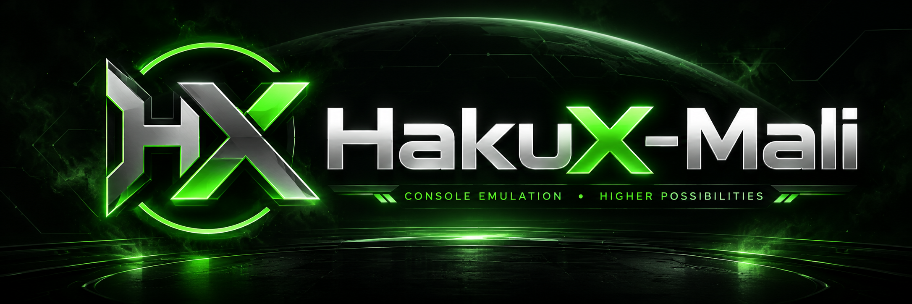
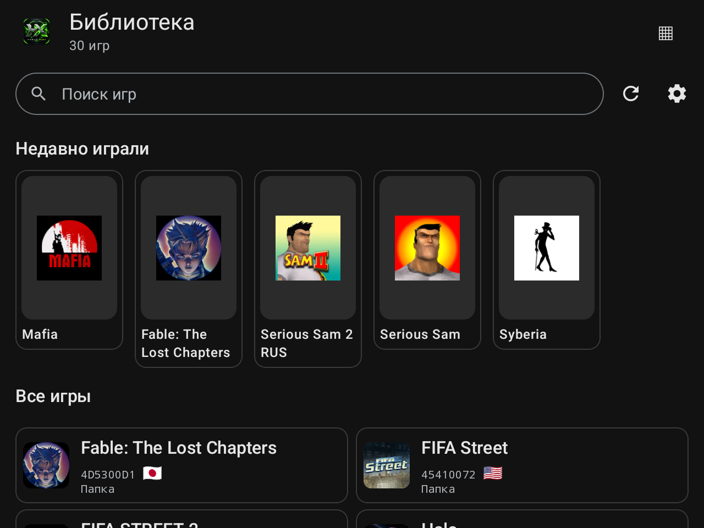
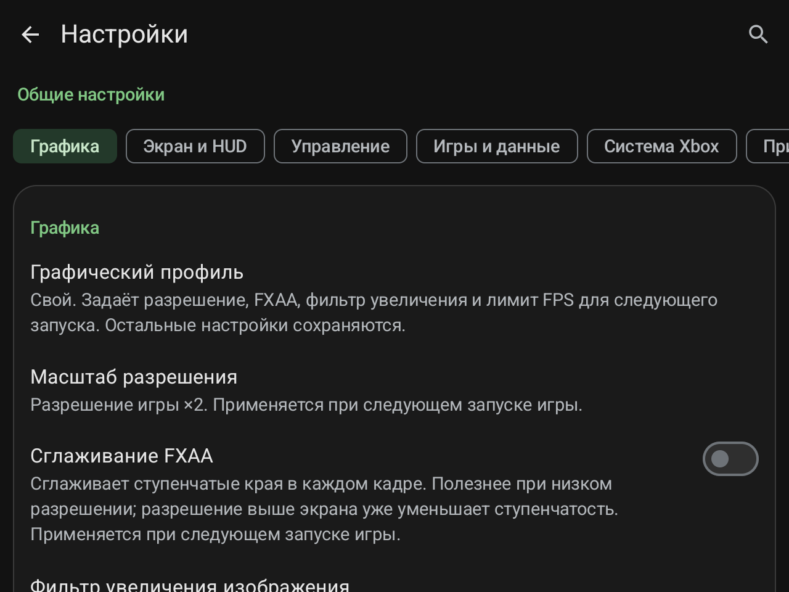

# HakuX-Mali

[Русский](README.md) | [English](README.en.md)

Бесплатная неофициальная адаптация [hakuX](https://github.com/rfandango/hakuX) для **ANBERNIC RG477M / Mali-G615 MC6** с экспериментальной поддержкой **ANBERNIC RG VITA Pro / RK3576 / Mali-G52**, Android arm64 и **MaliSX2 0.2.3**. Основа текущего релиза — hakuX 1.2.0. Авторство основного проекта и лицензии компонентов сохранены.

**1.2**: новый интерфейс библиотеки и меню, настройки по категориям и поиск, русский/английский язык, графические профили, настройки изображения и HUD, переопределения FPS для игр и исправления Syberia. **[Подробное описание](releases/1.2.ru.md) · [Скриншоты меню и настроек](docs/screenshots/1.2/README.md) · [Serious Sam: обход зависания загрузчика](docs/SERIOUS-SAM.ru.md).**

## Меню и настройки 1.2

Общие настройки разделены на шесть категорий; у игры доступны собственные переопределения с видимым наследованием. Поиск на русском и английском открывает нужную строку. В «Приложении» выбирается язык интерфейса, отдельно от языка Xbox. В «Графике» доступны профили Производительность / Баланс / Качество, яркость, контраст, насыщенность, гамма и сила GSR. Профили и изображение применяются при следующем запуске игры. GSR — фильтр увеличения изображения, MaliSX2 — Vulkan-драйвер.

HUD настраивается по размеру, углу, фону и отдельным температурам CPU/SoC, GPU, батареи; остаётся одна строка. Лимит новой установки — 120 FPS, существующие настройки сохраняются. **[Скриншоты всех основных экранов](docs/screenshots/1.2/README.md).**

В Syberia исправлены проверенные мерцание 3D, шлейф и обновление фона меню. Для некоторых русских папочных сборок **Serious Sam** с дополнительным меню/трейнером опубликована **[отдельная инструкция](docs/SERIOUS-SAM.ru.md)**. Она обходит загрузчик через `eng.xbe`; сохранение русской локализации не подтверждено.

Для ES-DE используйте **Microsoft Xbox → HakuX-Mali (Standalone)** в [нашем наборе конфигураций](https://github.com/Wannamingo/es-de-android-custom-systems). Сначала выдайте эмулятору доступ к той же папке игр. Подробности — в описании релиза.

## ANBERNIC RG VITA Pro

Сохранена **экспериментальная поддержка RG VITA Pro / RK3576 / Mali-G52** из сборки **1.2.0-rg477m.2-vita.2**: запуск системного Vulkan 1.3, встроенный MaliSX2 и температуры CPU/GPU/батареи в одной строке HUD. Проверена Android 14 / GammaOS Next Lite.

- [Текущий APK HakuX-Mali 1.2](https://github.com/Wannamingo/HakuX-Mali/releases/download/v1.2/HakuX-Mali-1.2-release.apk) · [Предыдущая проверка Vita Pro](releases/1.2.0-rg477m.2-vita.2.ru.md) · [Тесты и рекомендуемые настройки](docs/RG-VITA-PRO-PERFORMANCE.ru.md).
- Most Wanted, одна сохранённая сцена гонки: System 1x - **30 FPS**, System 1x + FXAA - **30 FPS**, System 2x - **29.9 FPS**, MaliSX2 2x - **21.4 FPS**. Начинать с **System driver / 1x**. 3x/4x дали около 18/10 FPS.
- Старый список 31 запуска относится к RG477M. Совместимость всех этих игр с Vita Pro не заявляется. Пятиминутный прогон включает экран результатов после выбывания; подробности и температуры приведены в отчёте.

## Скачать

**[HakuX-Mali 1.2 — APK, исходники и контрольные суммы](https://github.com/Wannamingo/HakuX-Mali/releases/tag/v1.2)**

Один APK `HakuX-Mali-1.2-release.apk` для Android arm64 с сохранённой поддержкой обеих консолей. Версия 1.2 установлена на RG477M с проверкой сохранности данных. Результаты Vita Pro относятся к предыдущей сборке: новых замеров 1.2 на этой консоли не проводилось. Это оптимизированная release-сборка без режима отладки. Package ID `com.rfandango.haku_x.debug` и прежняя подпись сохранены для обновления с сохранением данных.

## Установка

1. Установите `HakuX-Mali-1.2-release.apk` поверх нашей предыдущей версии — данные и настройки сохраняются.
2. При первой установке завершите настройку приложения и выберите каталог собственных Xbox ISO/XISO или игр в папках. Папка игры должна содержать `default.xbe` и остальные игровые файлы.
3. MaliSX2 0.2.3 уже встроен и автоматически выбирается при новой установке на RG477M / поддерживаемом MT6897. При обновлении прежний явный выбор системного или другого драйвера сохраняется; встроенный пакет доступен в Настройки → Графика → Драйвер GPU. После смены драйвера перезапустите игру.
4. При новой установке лимит по умолчанию — **120 FPS**; ранее сохранённое значение не меняется. Изменить его можно в Настройки → Экран и HUD → Ограничение FPS. Игры с внутренним лимитом 30/60 FPS сохраняют его.
5. Однострочный HUD показывает FPS, среднее/последнее время кадра и доступные температуры CPU/GPU/батареи.

Встроенная проверка обновлений обращается к Releases **Wannamingo/HakuX-Mali**. При переходе со старого имени установите **1.2 вручную один раз**: прежние версии используют старый адрес и другую нумерацию. Дальнейшие обновления HakuX-Mali проверяются в приложении; Android проверяет пакет и подпись.

## Исправления RG477M

- Импорт и загрузка MaliSX2 на RG477M с проверкой фактически выбранного драйвера и явной ошибкой загрузки.
- Очередь из 64 Vulkan fences и совместимый вывод кадров для драйверов без timeline semaphores.
- Syberia и Ultimate Beach Soccer: исправлен ранний выход при запуске файлового образа через обработку XBE media flags в памяти.
- Serious Sam: доставка гостевых SEH-исключений и сохранение прогресса REP MOVS устраняют вылет при запуске.
- Ultimate Spider-Man: сохранены атрибуты PAGE_WRITECOMBINE; использован расширенный вариант исправления памяти из 1.2.0 с MmSetAddressProtect и совместимым MM v2.
- Serious Sam: незавершённые/недоступные запросы видимости больше не дают ложный ноль; устранены чёрные помехи и сильная задержка управления.
- Warrior Within: линейная видеотекстура выбирается по pitch, размеру пикселя и размерам; исправлены полосы и растяжение нижней части видеовставок.
- The Two Thrones: невыровненные массивы вершин перепаковываются без изменения значений; исправлены лишние части модели и треугольники.
- The Sands of Time: точные границы текстур свечения убирают зелёную полосу справа, сохраняя сам эффект.
- The Sands of Time / MaliSX2 0.2.3: разделение legacy render pass при смене blending/write mask и синхронизация вложений устраняют чёрные мерцающие квадраты в небе и на полу.
- Лимиты FPS: без ограничения, 30, 60, 90, 120. На проверенной консоли сохранено 120 FPS; ограничитель не накапливает очередь кадров и не отменяет собственный лимит игры.
- Release HUD содержит одну строку FPS, среднего/последнего времени кадра и доступных температур CPU/GPU/батареи. Нижние диагностические строки и временные режимы экспериментов отсутствуют.
- Новая иконка из предоставленного изображения: обычная, адаптивная и монохромная версии для пяти плотностей, с сохранением пропорций.
- Перенос на hakuX 1.2.0: сохранены новые исправления звука, памяти, стеков, контроллеров и System Link. Флаги present_cpu_wait и rop_pass_split разделены; fpslimit перенесён в общий parser; hook-библиотеки adrenotools собраны согласованно.

Полное [описание релиза](releases/1.2.ru.md) и [технические детали](android/RG477M.md).

## Успешно запущенные игры на RG477M

**31 подтверждённый запуск**: 29 образов подтверждены владельцем 27.10.2026, Syberia — предыдущей проверкой, Call of Cthulhu — игровым уровнем на .2 28.10.2026. Это не подтверждение полного прохождения или отсутствия всех дефектов; прежние 30 игр не перепроверялись целиком на .2. [Область проверок и источники подтверждения](docs/COMPATIBILITY.md).

- Call of Cthulhu: Dark Corners of the Earth — игровой уровень работает; во вступительном ролике остаются пропавшие текстуры.
- Colin McRae Rally 2005
- Dead or Alive Xtreme Beach Volleyball
- Jet Set Radio Future
- Manhunt
- Midnight Club 3: DUB Edition
- Need for Speed: Carbon
- Need for Speed: Hot Pursuit 2
- Need for Speed: Most Wanted – Black Edition
- Need for Speed: Underground 2
- OutRun 2006: Coast 2 Coast
- Pinball Hall of Fame: The Gottlieb Collection
- Prince of Persia: The Sands of Time
- Prince of Persia: The Two Thrones
- Prince of Persia: Warrior Within
- Pro Evolution Soccer 5
- Pro Tennis WTA Tour (Europe)
- Rayman 3: Hoodlum Havoc
- Serious Sam
- Serious Sam II
- Soulcalibur II
- Spyro: A Hero’s Tail
- SSX on Tour
- Street Racing Syndicate (SRS)
- Syberia
- Tennis Masters Series 2003
- Ultimate Beach Soccer
- Ultimate Pro Pinball
- Ultimate Spider-Man
- WTA Tour Tennis (USA)
- XGRA: Extreme G Racing Association

Проверка 30.10.2026: **Manhunt** загружается напрямую из папки с 969 файлами; достигнут игровой уровень, около **50 FPS** в PAL-версии. Полное прохождение не проверялось.

## Известные ограничения

Дефект текстур вступительного ролика Call of Cthulhu пока не исправлен. Качество всех комикс-сцен Ultimate Spider-Man и длительные игровые сессии не проверены. Conker: Live & Reloaded пока не включена в подтверждённые игровые проверки. Dimensity 8300/8300 Ultra распознаётся по MT6897, но фактическое тестирование проведено на RG477M.

## Сборка и исходники

См. [android/README.md](android/README.md) и [android/RG477M.md](android/RG477M.md). Обычный GitHub ZIP не включает содержимое submodules; в релизе приложен отдельный архив исходников с FEX, использованными native-зависимостями, лицензиями и манифестом ревизий. Для adrenotools включён необходимый upstream-патч 1.2.0.

## Лицензия и авторство

hakuX — свободное ПО по **GPLv3 или более поздней версии**: [COPYING](COPYING), [LICENSE](LICENSE), [licenses/](licenses/). Основной проект: [rfandango/hakuX](https://github.com/rfandango/hakuX); FEX fork и APU на основе xemu сохраняют своё авторство и лицензии. Этот форк не связан с Microsoft или ANBERNIC. Игры, BIOS, HDD, пользовательские данные и закрытые ключи подписи не распространяются.
