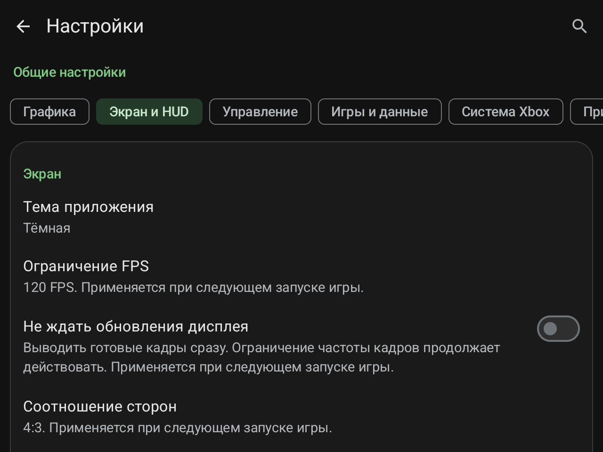
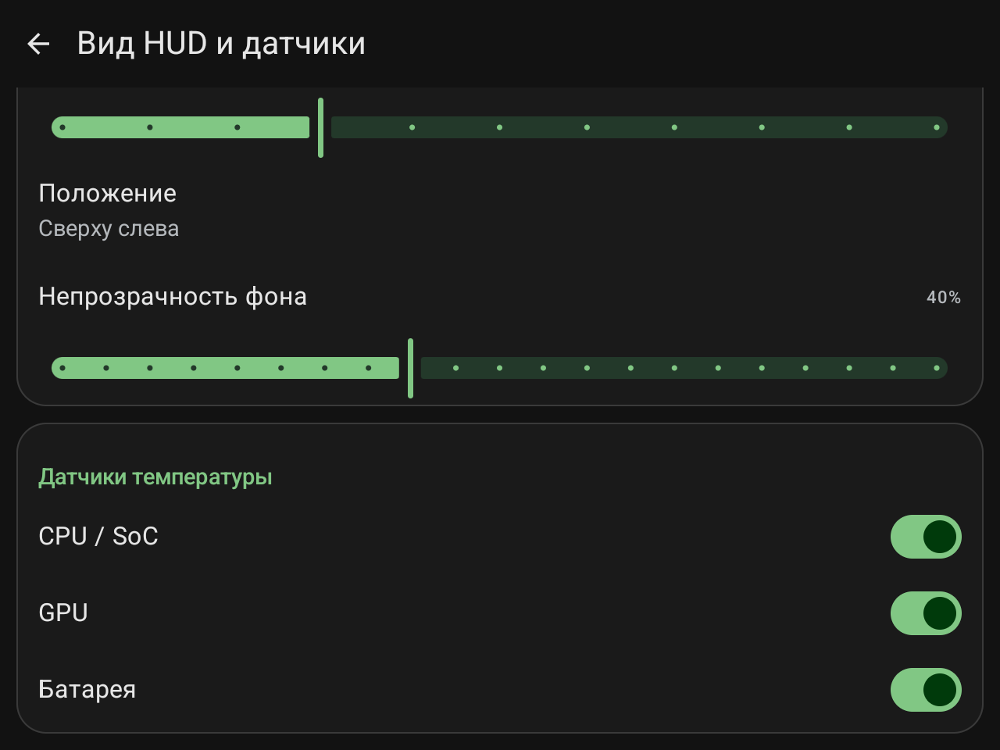
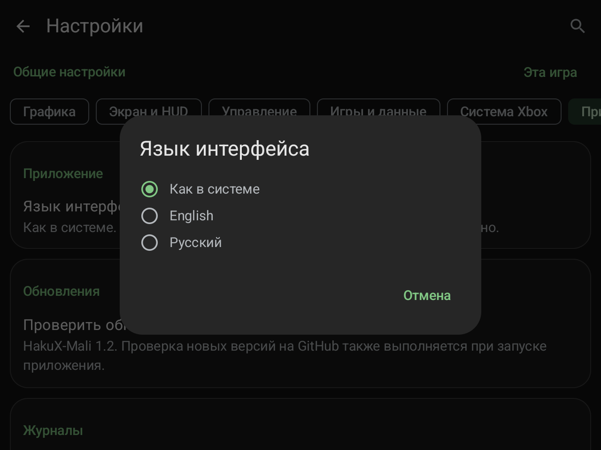
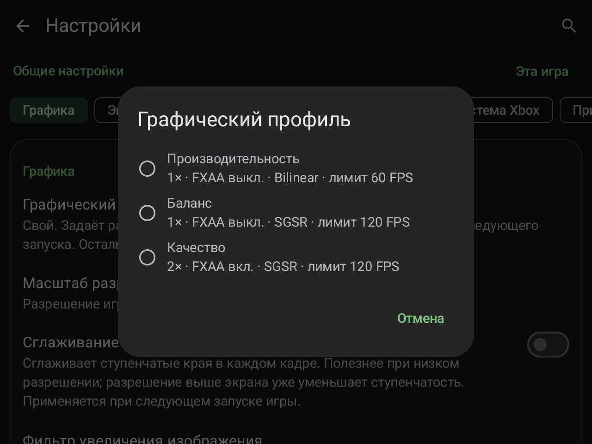
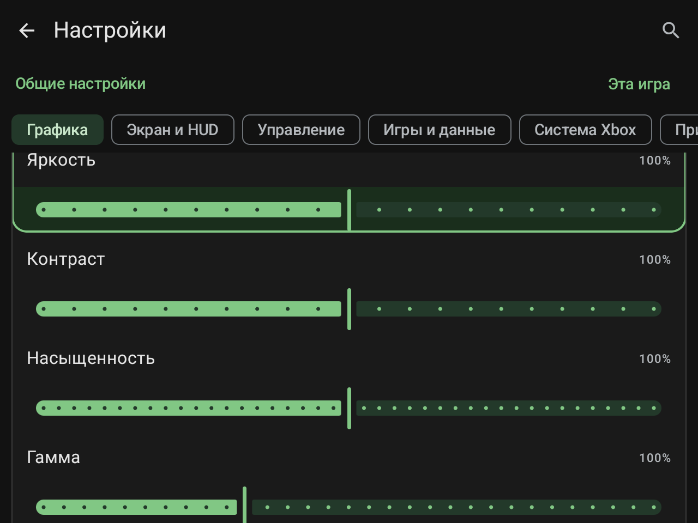

# HakuX-Mali 1.2 — меню и настройки / menus and settings

[Русская страница](../../../README.md) · [English page](../../../README.en.md)

Реальные снимки RG477M (1280×960), приложение **1.2 / versionCode 20**. PNG скопированы без обработки. Текущие настройки могут отличаться от настроек новой установки. Библиотека на снимке не является списком подтверждённой совместимости.

Actual RG477M captures (1280×960), app **1.2 / versionCode 20**. PNG files are unedited. Current settings may differ from fresh-install defaults. The pictured library is not a compatibility confirmation list.

## Библиотека: недавние игры и список / Library: recent games and list

## Боковое меню паузы / Pause sidebar

## Общие настройки графики / Global graphics settings

## Шрифт, положение и фон HUD / HUD font, corner and background

## Язык и обновления; версия 1.2 / Language and updates; version 1.2

## Настройки игры: наследование лимита 120 FPS / Per-game settings: inherited 120 FPS limit

## Лимит FPS и соотношение сторон / FPS limit and aspect ratio

## Независимые датчики температуры / Independent temperature indicators

## Выбор языка интерфейса / Interface language selection

## Три графических профиля / Three graphics profiles

## Настройки изображения / Picture controls

