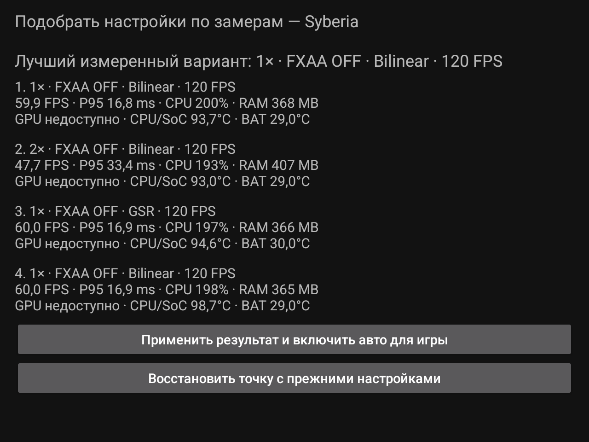
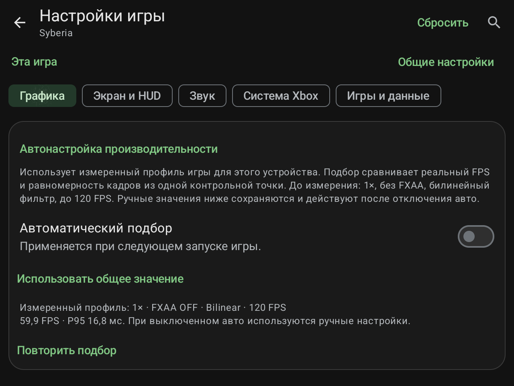
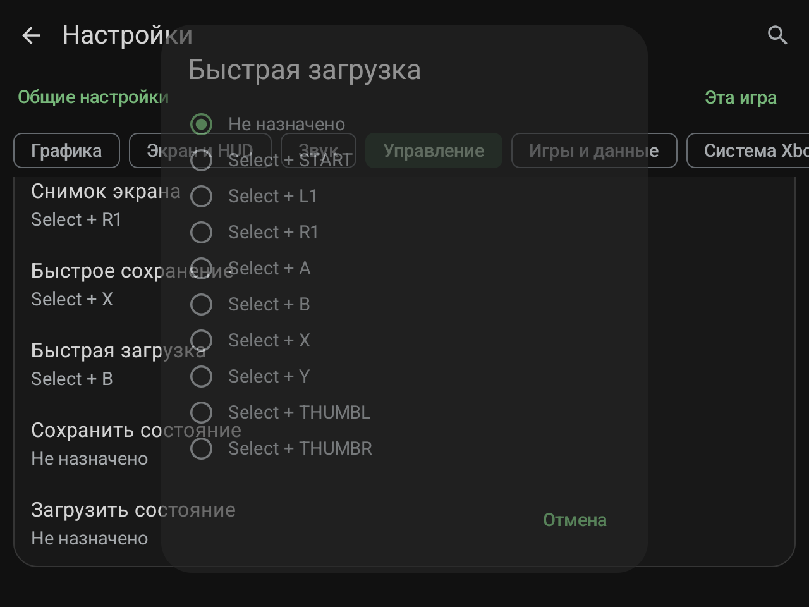
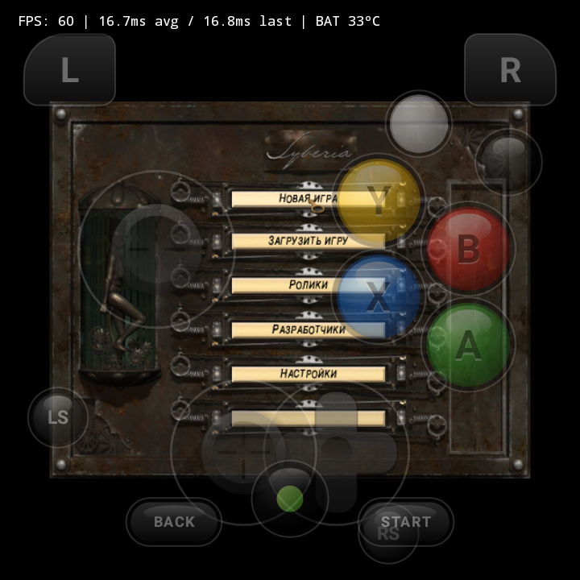
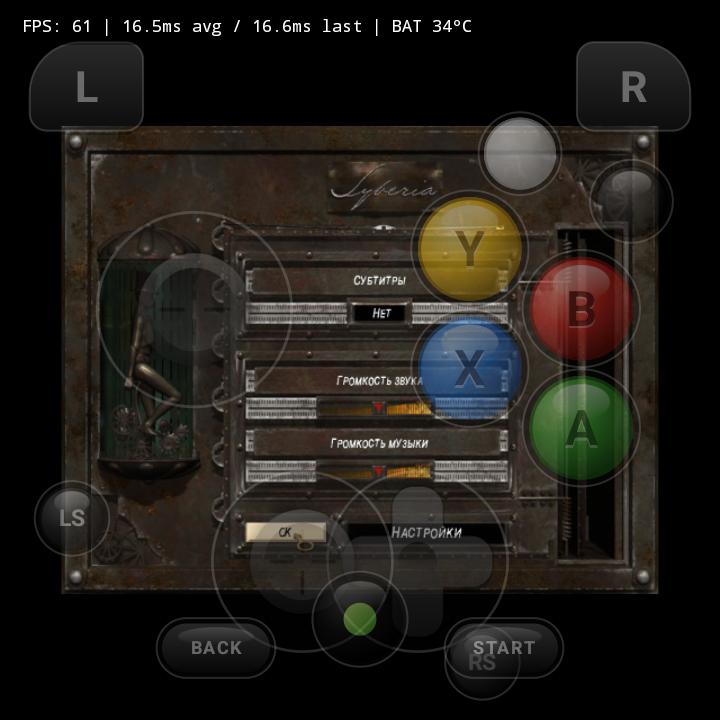

# HakuX-Mali 1.4 — скриншоты / screenshots

[Описание на русском](../../../releases/1.4.ru.md) · [English release notes](../../../releases/1.4.en.md)

## Измерительный подбор / measured calibration

RG477M, 1.4/code22, сборка `10d0a64`, до дополнения Syberia для Rotate. Это реальные результаты одного короткого сравнения сцены, не общий рейтинг игр. CPU — суммарное время процесса; GPU timing на G615 недоступно. Подробные температуры и границы проверки — в [отчёте](../../CALIBRATION-RG477M-1.4.ru.md).

RG477M, 1.4/code22 build `10d0a64`, before the Rotate Syberia extension. Actual results from one short scene comparison, not a general game ranking. CPU is aggregate process time; G615 GPU timing is unavailable. See the [test report](../../CALIBRATION-RG477M-1.4.en.md).

## Сочетания геймпада / gamepad shortcuts

Функция добавлена в 1.3 и сохранена в 1.4; снимок из проверки 1.3/code21 на RG477M. Показанные назначения — пример, их выбирает пользователь.

Introduced in 1.3 and retained in 1.4; captured during RG477M 1.3/code21 testing. Shown bindings are user-selected examples.

## Исправленное меню Syberia / corrected Syberia menu

RG Rotate, итоговый единый APK 1.4/code22, код ядра `363f86c`, системный Vulkan 1.1, прямой доступ к памяти. Экранные кнопки временно показаны для проверки переходов.

RG Rotate, final unified 1.4/code22 APK, executable code `363f86c`, system Vulkan 1.1 with imported shared RAM. Touch controls were temporarily shown to test menu navigation.

[Основные экраны библиотеки и настроек / main library and settings screens from 1.2](../1.2/README.md)
