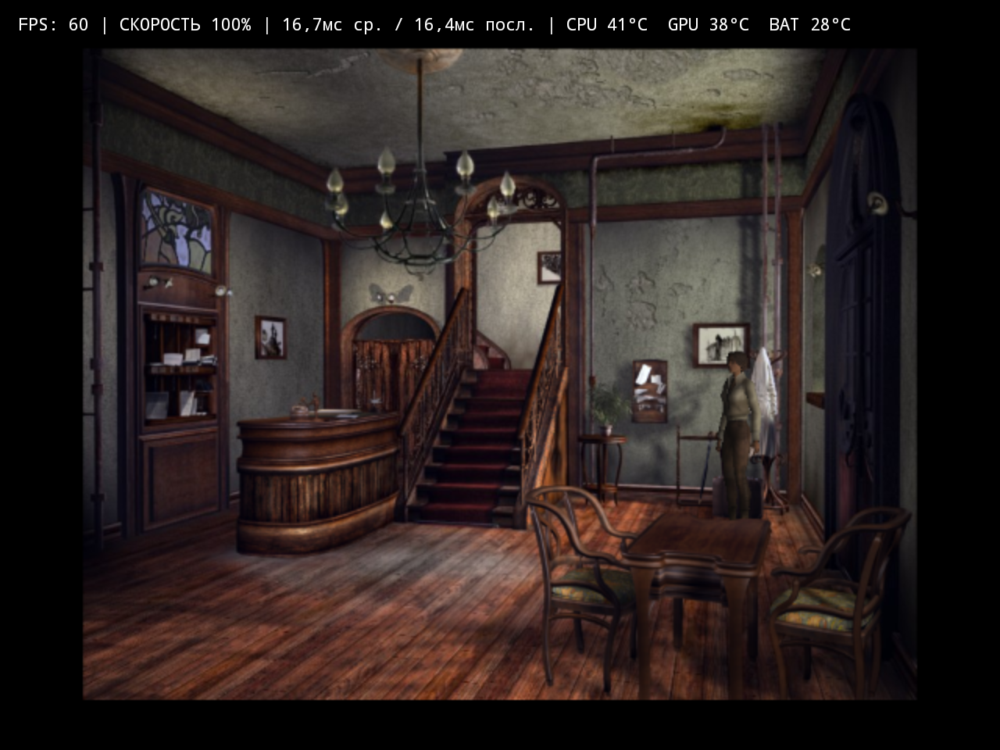
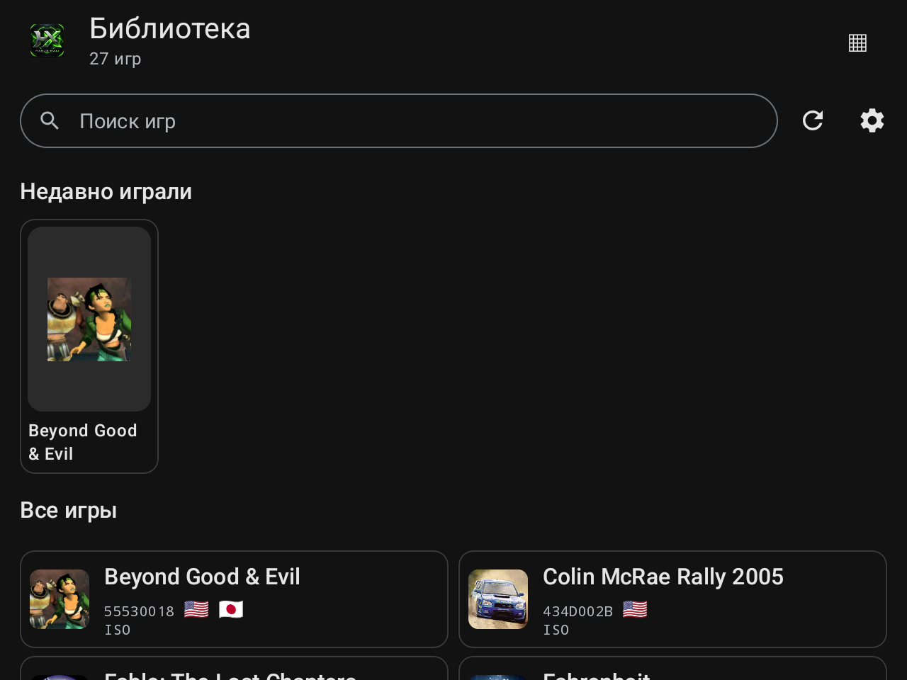
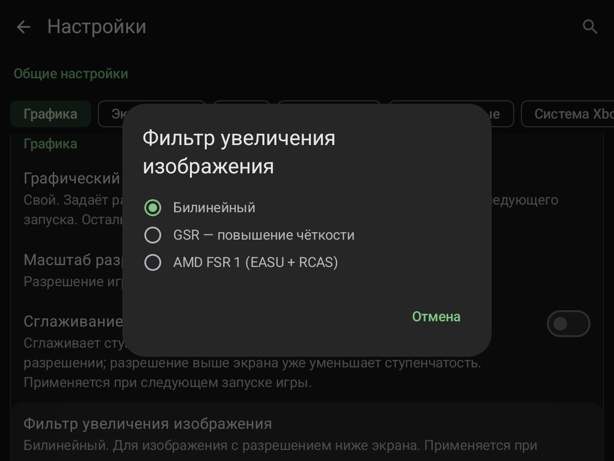
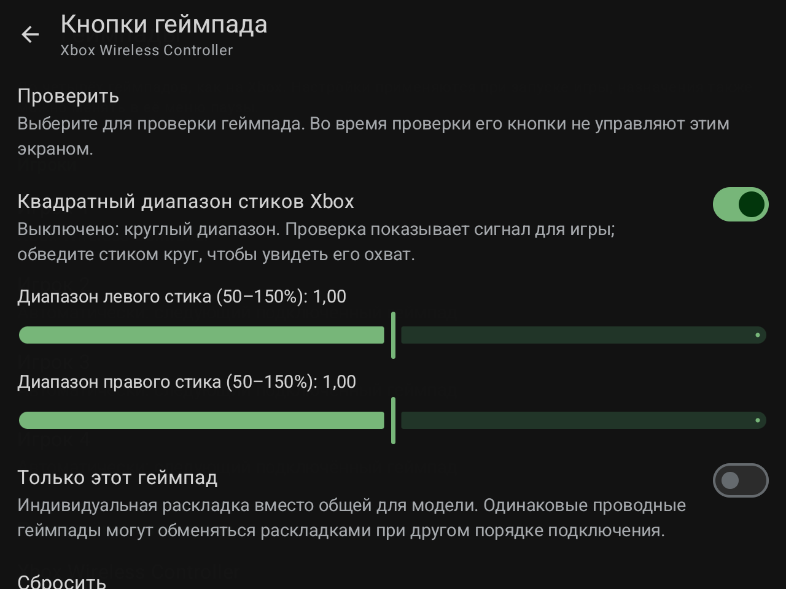
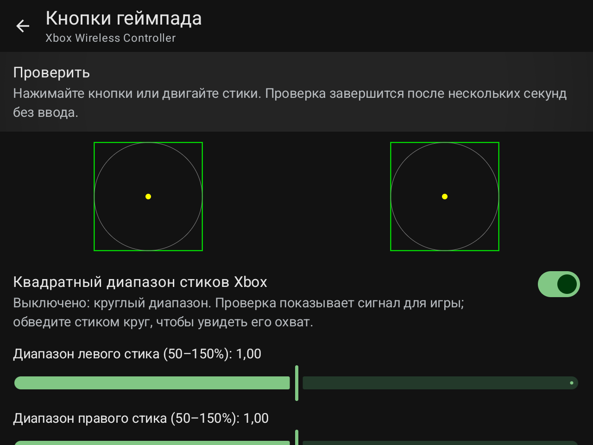
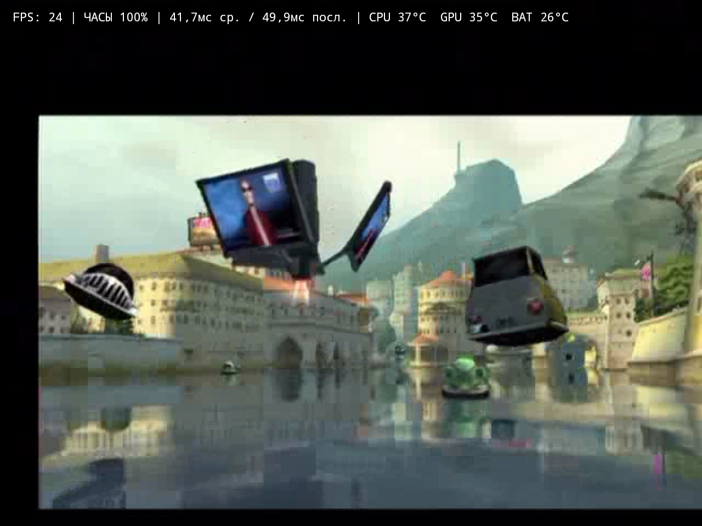
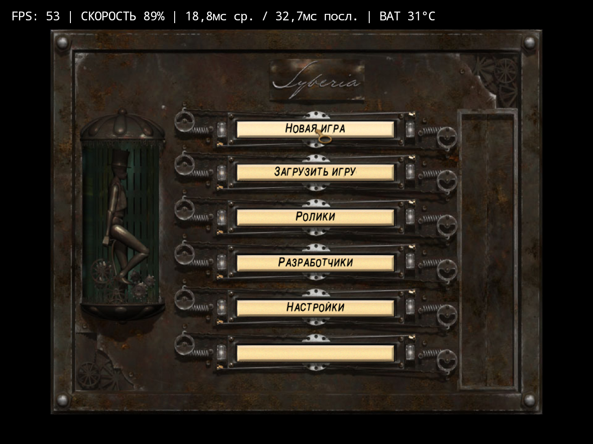

# HakuX-Mali 1.6 — интерфейс / interface

Снимки RG477M с проверочной линией 1.6. Новые настройки добавлены к прежнему оформлению. Изображение игры приведено для проверки вывода и FSR; цифры FPS во вступительном ролике не являются сравнительным бенчмарком.

RG477M screenshots from the 1.6 validation line. Existing artwork is retained. The game image demonstrates output and FSR; introductory-movie FPS is not a comparative benchmark.

## Итоговый HUD в игре / Final in-game HUD

Итоговый APK **1.6/code26**, встроенный Unified P48r1, первый игровой уровень Syberia. Проверены отображение «СКОРОСТЬ», пауза и продолжение. Это короткая функциональная проверка; числа на кадре не являются сравнительным бенчмарком.

Final **1.6/code26** APK, bundled Unified P48r1, Syberia gameplay. The Russian SPEED label, pause and resume were verified. This is a short functional check; the captured numbers are not a comparative benchmark.

## Библиотека / Library

## Фильтры увеличения / Upscaling filters

## Настройки стиков / Stick settings

## Визуальная проверка / Visual controller test

## FSR 1 — Beyond Good & Evil

Вступительный ролик / introductory movie. Проверка ядра с EASU + RCAS, 640×480 → 1280×960. Снимок ранней проверочной сборки до переименования «ЧАСЫ» в «СКОРОСТЬ». / Core validation with EASU + RCAS, 640×480 → 1280×960. Captured on the earlier validation build, before CLOCK was renamed to SPEED.

## RG476H — Syberia / Unified P48r1

Итоговый APK 1.6/code26: главное меню на штатной Android 13, встроенный P48r1. Короткая проверка запуска, не FPS-бенчмарк. Последний пустой пункт этой копии игры встречался и ранее. / Final APK 1.6/code26: main menu on stock Android 13 with bundled P48r1. Short launch check, not an FPS benchmark. This game copy also had the blank final menu entry on earlier builds.

