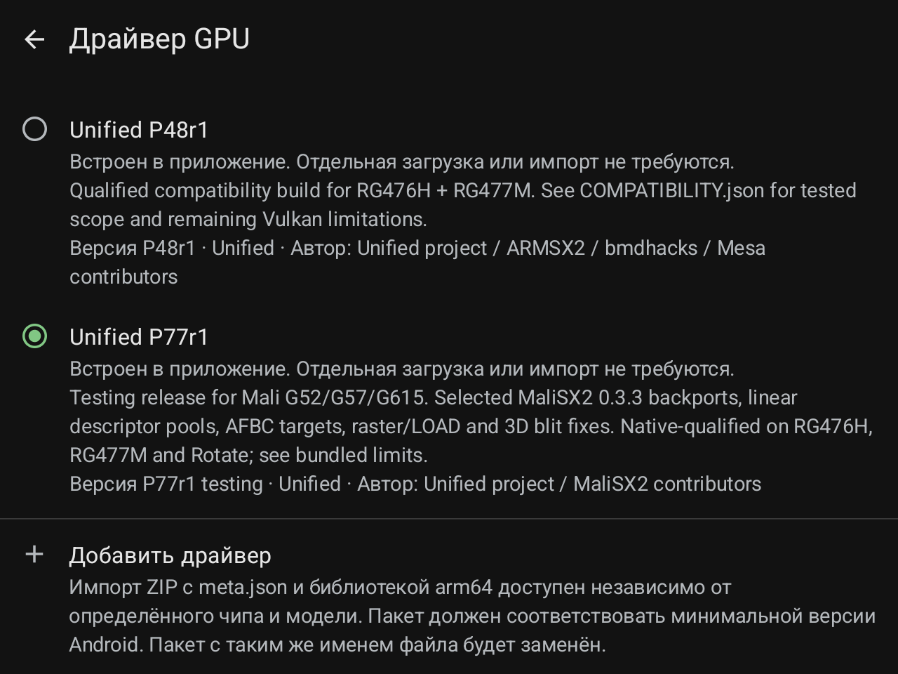
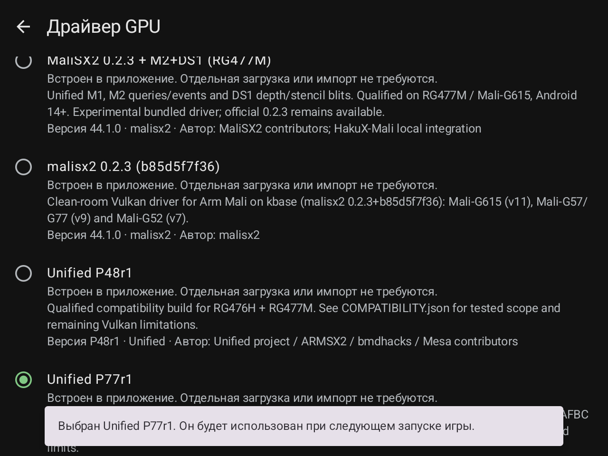
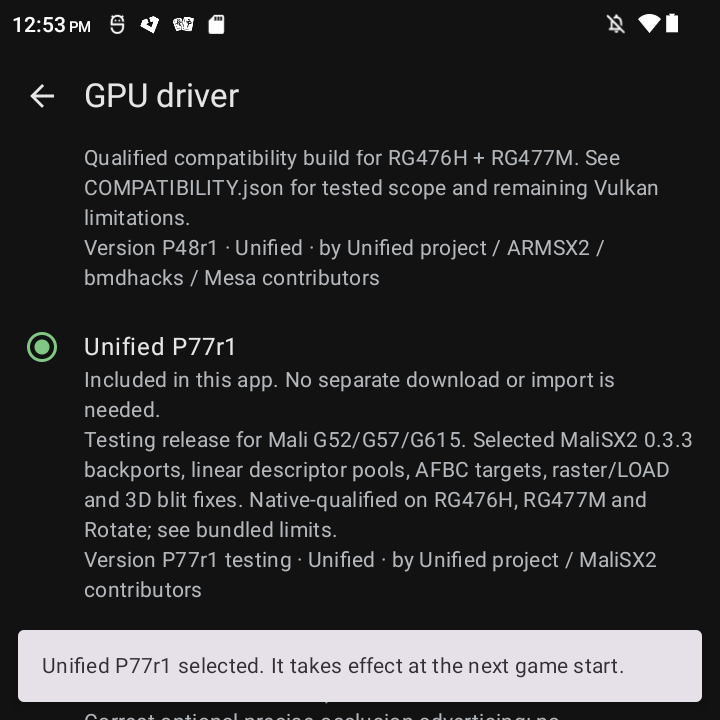

# HakuX-Mali 1.7: драйверы / drivers

Реальные снимки с трёх консолей во время проверки ручного выбора встроенного
P77r1. После проверки возвращены прежние драйверы: M2+DS1 / System / P52.
Это не скриншоты игрового теста или измерения FPS.

Actual captures during bundled P77r1 selection tests. The original M2+DS1 /
System / P52 selections were restored afterwards. These are UI checks,
not gameplay or FPS benchmarks.

## RG477M

## RG476H

## RG Rotate

