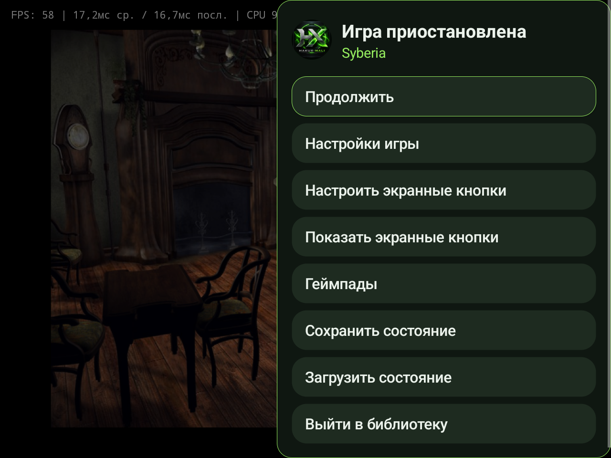
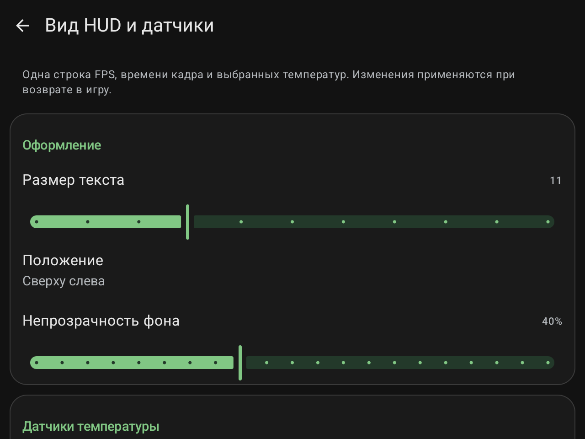
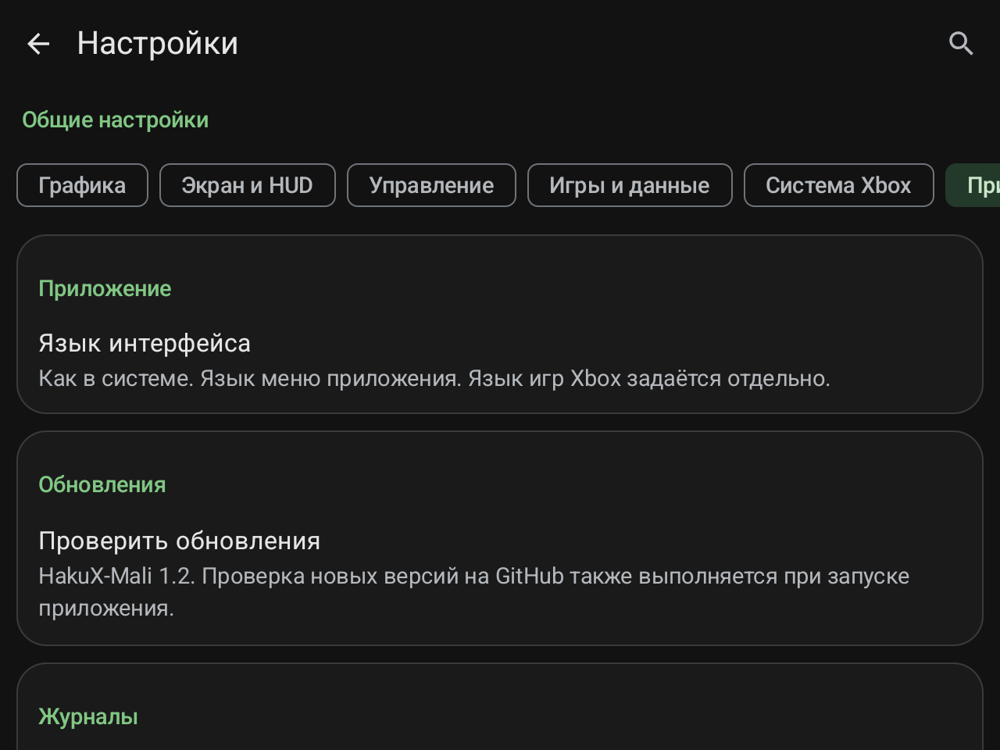
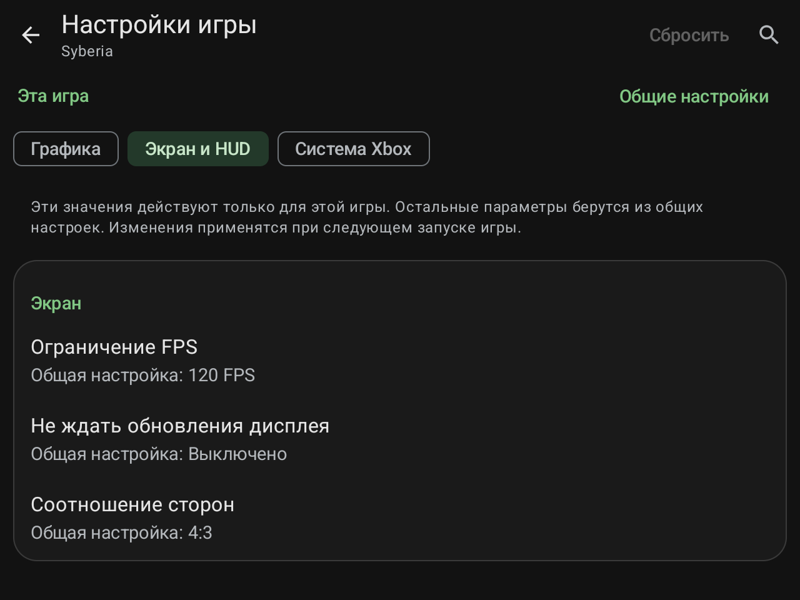

# HakuX-Mali 1.2

[Русский](1.2.ru.md) | [English](1.2.en.md)

Релиз от 30.10.2026. **Версия приложения 1.2, versionCode 20**, основа — hakuX 1.2.0. Android 9+ / arm64-v8a, оптимизированная release-сборка. Поддержка RG477M / Mali-G615 и экспериментальная поддержка RG VITA Pro / RK3576 / Mali-G52 сохранены. MaliSX2 0.2.3 встроен; прежние иконка HX, подпись и package ID сохранены.

## Новый интерфейс

### Библиотека и меню игры

- Библиотека получила сетку обложек и компактный список. Можно менять размер карточек, быстро возвращаться к недавно запущенным играм и назначать свою обложку.
- Игры из ISO/XISO и папок с `default.xbe` остаются в общей библиотеке. Папка игры отображается одной карточкой; игровые ресурсы не становятся отдельными играми.
- Меню паузы открывается боковой панелью: продолжение, настройки текущей игры, экранные кнопки, геймпады, сохранение/загрузка состояния и выход в библиотеку.
- Навигация учитывает крестовину и кнопки A/B/Start. Исправлены возврат из настроек в игру и запасная обработка Start.

### Настройки по категориям

Настройки разделены на **«Графика», «Экран и HUD», «Управление», «Игры и данные», «Система Xbox», «Приложение»**. У каждого раздела сохраняется своя позиция прокрутки. Исправлена ошибка, при которой после смены категории мог оставаться рисунок предыдущего раздела.

Поиск работает с русскими и английскими названиями, переводит к нужной категории и выделяет найденную строку. Экранная клавиатура больше не перекрывает результаты; автокоррекция поиска выключена.

Общие настройки и параметры **только текущей игры** разделены. Видно, какое значение наследуется и где задано переопределение. Сброс настроек игры требует подтверждения и очищает только её переопределения. Не все общие настройки имеют вариант для отдельной игры.

### Русский и английский языки

В разделе приложения можно выбрать **«Как в системе», English или Русский**. Переведены библиотека, меню паузы, настройки и диалоги. Язык интерфейса не меняет язык эмулируемой Xbox. Переключение языка в меню не перезапускает гостевую игру.

## Профили и изображение

Профиль меняет ровно четыре параметра; выбранный Vulkan-драйвер, видеорежим Xbox и исправления совместимости сохраняются.

| Профиль | Разрешение | FXAA | Увеличение изображения | Лимит FPS |
|---|---|---|---|---|
| Производительность | 1x | Выкл. | Билинейный | 60 |
| Баланс | 1x | Выкл. | GSR | 120 |
| Качество | 2x | Вкл. | GSR | 120 |

После ручного изменения сочетания параметров показывается пользовательский профиль. Названия профилей не гарантируют конкретную частоту кадров на любом устройстве; для RG VITA Pro по прежним тестам разумно начинать с **System driver / 1x**.

- Для игры можно задать собственный лимит FPS или наследовать общий. В меню: без ограничения, 30, 60, 90 и 120. На новой установке общий лимит по умолчанию — **120 FPS**; обновление сохраняет прежний выбор. Внутренний лимит игры 30/60 FPS не снимается.
- Добавлены яркость **50–150%**, контраст **50–150%**, насыщенность **0–200%**, гамма **50–200%** и сила GSR **0–100%**. Настройки изображения вступают в силу **при следующем запуске игры**, как указано в меню.
- По умолчанию все эти параметры равны **100%**, прежний вид картинки сохранён. GSR 0% соответствует билинейному увеличению, 50% смешивает варианты, 100% использует исходный GSR.
- **GSR — фильтр увеличения изображения**, независимый от драйвера MaliSX2. Название в интерфейсе: «GSR — повышение чёткости».
- Цветокоррекция встроена в существующий вывод кадра после Xbox gamma ramp; отдельный проход рендеринга для неё не добавлен.

## Настраиваемый HUD и температуры

HUD остаётся **одной строкой**: FPS, среднее/последнее время кадра и выбранные доступные температуры. Нижние диагностические строки отсутствуют.

- Размер шрифта **8–18 sp**, по умолчанию 11 sp.
- Положение в одном из четырёх углов, по умолчанию слева сверху.
- Непрозрачность фона **0–100%**, по умолчанию 40%.
- Температуры CPU/SoC, GPU и батареи включаются независимо. Недоступные датчики пропускаются; CPU может использовать доступное значение SoC.
- Когда все температуры отключены, их опрос прекращается. Обычный период опроса — 2 секунды.
- Изменения HUD применяются после возврата из настроек в игру. Для длинной строки используется сокращение текста, выбранный размер шрифта самопроизвольно не уменьшается.

## Исправления Syberia

Исправлен учёт изменённых страниц после 2D-копирования фона как для GPU-копии, так и для загрузки через CPU. Повторная загрузка старого фона больше не должна затирать уже нарисованную 3D-графику. Также упорядочены GPU-readback и копирование через CPU, устраняя проверенный эффект шлейфа при смене сцены. Эти две правки относятся к общей обработке копирования.

Для **Syberia / MaliSX2 без zero-copy** отдельно ограничена лишняя синхронизация полного кадра на idle-границе: она могла возвращать старый фон после выбора пункта меню. Обычная синхронизация сохранена; на другие игры это специальное условие не распространяется. Владелец подтвердил правильное обновление фона и исправную работу после проверки. Это не обещание устранения всех возможных дефектов во всех играх.

Сохранены предыдущие исправления запуска Syberia и Ultimate Beach Soccer, памяти Ultimate Spider-Man, запросов видимости Serious Sam, видео Warrior Within, геометрии The Two Thrones, свечения и мерцающих квадратов The Sands of Time. [Полный перечень предыдущих правок](1.0.ru.md).

## Важно для русскоязычных пользователей: Serious Sam

В проверенной папочной сборке **T-Rus Ryudo** зависает цепочка дополнительного меню и трейнера: `default.xbe → game.xbe → eng.xbe`. Прямой запуск настоящей игры достиг игрового уровня.

1. Закройте игру.
2. Сохраните исходный `default.xbe` под свободным резервным именем, например `default.xbe.hakux-launcher.bak`.
3. **Скопируйте `eng.xbe` в `default.xbe`**, оставив оригинал `eng.xbe` на месте.
4. Остальные файлы, включая `.gro`, не меняйте. Обновите библиотеку и запускайте папку.

Это обход стороннего загрузчика для папки с указанными файлами, а не автоматический патч всех русских версий. **Сохранение русской локализации при использовании английского `eng.xbe` не подтверждено.** Подробности, условия применения и отмена изменения: **[инструкция Serious Sam на русском](../docs/SERIOUS-SAM.ru.md)**. Игровые файлы в релиз не включены.

## ES-DE

В [нашем наборе систем ES-DE](https://github.com/Wannamingo/es-de-android-custom-systems) в ветке `main` добавлены **Microsoft Xbox** и **HakuX-Mali (Standalone)**. Скопируйте файлы конфигурации по инструкции этого репозитория; для папок используется `default.xbe`. Сначала выдайте HakuX-Mali доступ к той же папке игр. Изменение в исходный набор GlazedBelmont предложено в [PR #126](https://github.com/GlazedBelmont/es-de-android-custom-systems/pull/126); принятие PR не требуется для использования нашего набора. Контракт запуска проверен по XML и APK; полный запуск через ES-DE отдельно не тестировался.

## Скриншоты меню и настроек

Реальные снимки RG477M, HakuX-Mali 1.2; показаны текущие настройки консоли, которые могут отличаться от значений по умолчанию. [Все снимки с подписями](../docs/screenshots/1.2/README.md). Отдельные PNG приложены к релизу.

## Проверки и ограничения

Сборка 1.2 сохраняет native-библиотеки, MaliSX2 и изображения иконки из проверенной сборки интерфейса versionCode 19. Для этой линии выполнены **46 JVM-тестов**, release/R8, lintVitalRelease, компиляция пяти встроенных GLSL-шейдеров для Vulkan 1.1/1.3, проверка подписи v3 и выравнивания ZIP/ELF на 16 KiB. На RG477M проверены категории, поиск с клавиатурой, RU/EN/System, профили, настройки игры, изображение и HUD, возврат в игру, сохранённые сцены Syberia и прямой запуск Serious Sam. Итоговый APK 1.2 установлен поверх предыдущего с проверкой контрольных сумм существующих сохранений и сохранности настроек; скриншоты сняты с него.

[31 исторически подтверждённый запуск на RG477M](../docs/COMPATIBILITY.md) не означает повторное тестирование всех игр в 1.2 или полное прохождение. На RG VITA Pro новых замеров 1.2 не проводилось; [предыдущий отчёт Most Wanted](../docs/RG-VITA-PRO-PERFORMANCE.ru.md) остаётся ориентиром с указанными там ограничениями. Прежние случаи device lost/out-of-memory на Vita Pro не объявляются исправленными. Во вступлении Call of Cthulhu остаётся дефект текстур; все комикс-сцены Ultimate Spider-Man и Conker не подтверждены полной игровой проверкой.

## Установка и исходники

Установите **HakuX-Mali-1.2-release.apk** поверх нашей предыдущей сборки. Сохраняются подпись, package ID `com.rfandango.haku_x.debug`, доступ к играм, настройки и сохранения. На переходе с очень старых сборок при необходимости установите APK вручную; последующая проверка обновлений использует **Wannamingo/HakuX-Mali**.

В релизе: APK, полный архив соответствующих исходников с submodules и использованными native-зависимостями, патч к hakuX 1.2.0, манифест ревизий, отчёт проверок, RU/EN-документация, PNG и SHA-256. Обычный архив GitHub Source code не включает содержимое submodules. GPLv3+; авторство hakuX, FEX и остальных компонентов сохранено. Игры, HDD и пользовательские данные не распространяются.
