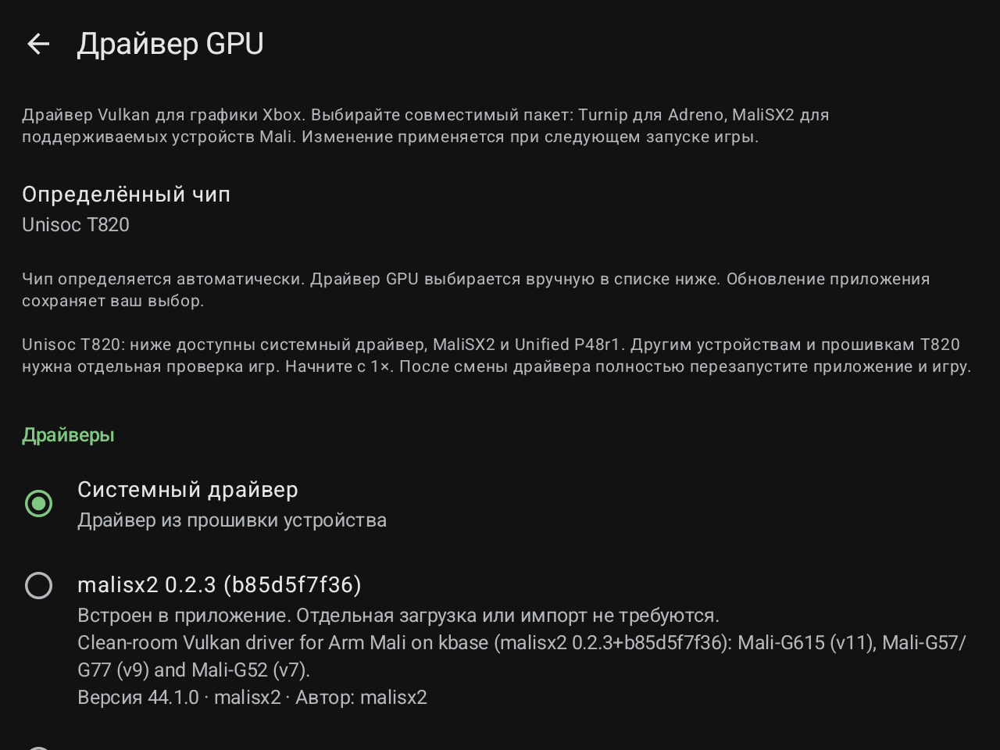

# HakuX-Mali 1.6.1 / code29

Fixes the GPU driver selection page. The chip is detected automatically; the user selects the driver manually in Settings.

| Chip | Bundled choices alongside System driver |
|---|---|
| Unisoc T820 | MaliSX2 0.2.3 and Unified P48r1 |
| Unisoc T618 | Unified P48r1, experimental |
| Dimensity 8300 / 8300 Ultra | MaliSX2 0.2.3 and Unified P48r1; existing M2+DS1 retained for RG477M |

The catalogue follows the chip without hiding packages based on Android version. Actual binary requirements still apply: bundled Unified P48r1 requires API 33 (Android 13), M2+DS1 API 34 (Android 14), and MaliSX2 0.2.3 API 29 (Android 10). On an older system the package remains visible with an explanation, but cannot be loaded. A visible entry does not establish binary compatibility with every Android version.

Detection covers T820/T618 marketing names, MT6897, Dimensity 8300/8300 Ultra and vendor properties. The RG476H GammaOS T770 reporting workaround and RG556 recognition are retained. UMS512 fallback requires an exact known T618 model (RG405M, RG505 or RG Rotate); a generic board name does not enable other chips.

Updates retain the current selection. New T820/T618 and other Dimensity 8300 family devices keep System driver by default. Historical RG477M and Vita Pro defaults are retained. Fully restart the app and game after changing the driver.

## Validation scope and known issues

- Unified has not been tested on a physical T618. This is an experimental choice, not a game-compatibility or full-Vulkan qualification.
- Other T820/Dimensity 8300 devices and firmware need their own tests; checks on a particular RG477M or RG476H do not qualify every firmware.
- The owner reported missing textures and occasional flickering in **Dead or Alive Xtreme Beach Volleyball on RG476H with System driver**. This version does not fix that issue.
- In **Need for Speed: Most Wanted on RG476H**, the owner observed Unified running slower than System driver. This was not a controlled performance comparison; Unified is not labelled the fastest driver.

The emulator core, bundled driver libraries, icon, 120 FPS ceiling and HUD are retained from 1.6. Experimental P49/P50/P51 builds are not included. Games, BIOS, MCPX ROM, user HDD images and states are not distributed. Install over the previous version without deleting application data.

## Model references

The manufacturer specifies T618 for [RG405M](https://anbernic.com/a/shop/products/rg405m) and [RG505](https://anbernic.com/en-fr/products/rg505). Model detection chooses the catalogue; it does not replace physical driver validation.

## Version 1.6.1 validation

All 109 Android unit tests and release lint passed. The signed APK was installed over the previous build on RG477M and RG476H, retaining the selected driver, settings and states. The Unisoc T820 label and manual driver page were checked on RG476H. RG477M installation/data preservation was verified; automation did not obtain the first UI snapshot, so no separate UI-verification claim is made.

All eight native libraries, bundled drivers and the icon match 1.6 byte for byte. These checks cover the UI/catalogue update, not a new FPS or game-compatibility benchmark. [Machine-readable validation](../docs/VALIDATION-1.6.1.json).

