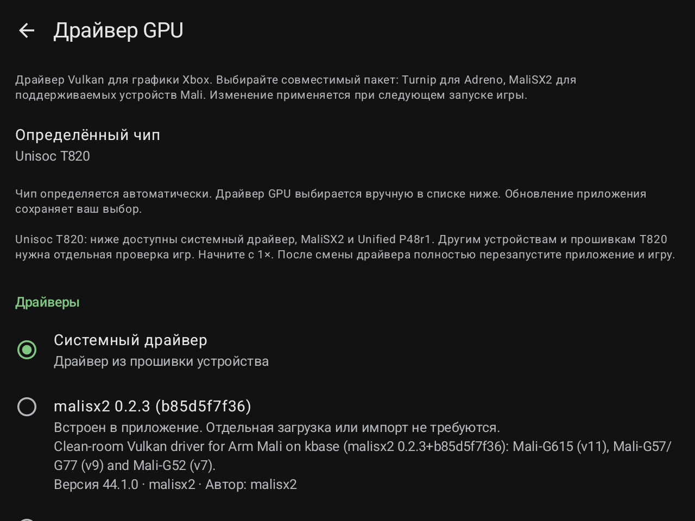

# HakuX-Mali 1.6.1 / code29

Исправление страницы выбора драйверов GPU. Чип определяется автоматически, драйвер пользователь выбирает вручную в настройках.

| Чип | Встроенные варианты помимо системного драйвера |
|---|---|
| Unisoc T820 | MaliSX2 0.2.3 и Unified P48r1 |
| Unisoc T618 | Unified P48r1, экспериментально |
| Dimensity 8300 / 8300 Ultra | MaliSX2 0.2.3 и Unified P48r1; прежний M2+DS1 сохранён для RG477M |

Список формируется по чипу, без скрытия пакетов по версии Android. При этом настоящие требования библиотеки сохраняются: включённый Unified P48r1 требует API 33 (Android 13), M2+DS1 — API 34 (Android 14), MaliSX2 0.2.3 — API 29 (Android 10). На более ранней системе пакет виден с пояснением, но недоступен для загрузки. Отображение пункта не означает совместимость бинарного файла с любой версией Android.

Распознаются названия T820/T618, MT6897 и Dimensity 8300/8300 Ultra, а также vendor-свойства прошивки. Сохранены обход неправильного T770 на RG476H с GammaOS и распознавание RG556. Для UMS512 используется точное совпадение с известной моделью T618 (RG405M, RG505, RG Rotate); одно общее название платы не включает поддержку другого чипа.

Текущий выбор при обновлении сохраняется. Для новых T820/T618 и других устройств семейства Dimensity 8300 по умолчанию остаётся системный драйвер. Прежние значения RG477M и Vita Pro сохранены. Смена драйвера применяется после полного перезапуска приложения и игры.

## Границы проверки и известные проблемы

- Unified на физическом T618 пока не проверен. Это экспериментальный вариант, а не подтверждение совместимости игр или полного Vulkan.
- Новые устройства семейства T820/Dimensity 8300 требуют собственных проверок. Проверки конкретной RG477M или RG476H не распространяются автоматически на все прошивки.
- Владелец сообщил о пропавших текстурах и редком мерцании в **Dead or Alive Xtreme Beach Volleyball на RG476H с системным драйвером**. Сбой не исправлен этой версией.
- По наблюдению владельца в **Need for Speed: Most Wanted на RG476H** Unified медленнее системного драйвера. Сравнение не является контролируемым тестом производительности; Unified не обозначается как самый быстрый драйвер.

Ядро эмулятора, встроенные библиотеки драйверов, иконка, лимит 120 FPS и HUD сохранены из 1.6. Экспериментальные P49/P50/P51 в этот APK не включены. Игры, BIOS, MCPX ROM, пользовательские HDD и состояния в релиз не входят. Устанавливайте поверх прежней версии без удаления данных.

## Сведения о моделях

Официальные характеристики производителя подтверждают T618 в [RG405M](https://anbernic.com/a/shop/products/rg405m) и [RG505](https://anbernic.com/en-fr/products/rg505). Распознавание модели является правилом выбора каталога и не заменяет тестирование драйвера на устройстве.

## Проверка версии 1.6.1

Прошли 109 Android unit-тестов и release lint. Подписанный APK установлен поверх прежней сборки на RG477M и RG476H; выбор драйвера, настройки и состояния сохранены. На RG476H проверены подпись «Unisoc T820» и страница ручного выбора. Для RG477M подтверждена установка и сохранность данных; автоматизация не получила первый снимок интерфейса, поэтому отдельная UI-проверка не заявляется.

Все восемь нативных библиотек, встроенные драйверы и иконка побайтно совпадают с 1.6. Это проверка обновления интерфейса и политики выбора, не новый тест FPS или совместимости игр. [Машиночитаемая проверка](../docs/VALIDATION-1.6.1.json).

